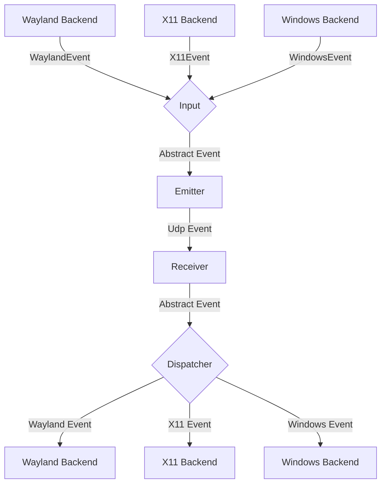
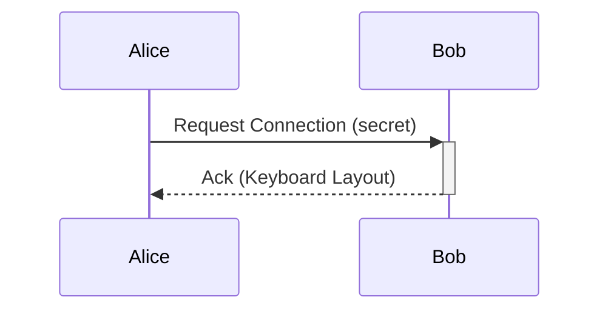

# General Software Architecture

## Streaming clipboard files

Copying files captures names, local paths and 64-bit sizes only. It does not read
file contents or change the source clipboard. A completed device switch starts
sharing the pending selection with that peer. File contents use a separate TLS
1.3 TCP stream on the configured Lan Mouse port; allow TCP from authorized peers
in addition to the existing UDP rule. Mouse and keyboard traffic stays on DTLS.
Both peers must support file stream version 1. Legacy whole-buffer file messages
are rejected; files never fall back to the text/image fragment transport.

The authenticated DTLS connection carries `FileStreamOffer`, type 17, version 1:
`[u8 type][u8 version][u16 TCP port][u64 total bytes][u32 file count]`
`[32-byte one-use capability][DER certificate]`. The receiver pins this exact
certificate and presents the capability over TLS. The sender accepts the input
peer's IP only. Private keys, capabilities and certificates are not logged.

Each file is streamed as `[u32 UTF-8 name length][name][u64 size][contents]`
`[32-byte SHA-256]`. Local paths never leave the source. Bounded copy buffers and
incremental checksums keep memory independent of file size. Disk and TLS work
run outside the input event loop. Transfer pacing reuses the existing clipboard
burst budget. There is no 256 MiB file limit; text and image limits are unchanged.

The receiver stages files in its configured download directory, checks every
length and checksum, and exposes the batch only after all files validate.
Existing names receive a numbered suffix and are never overwritten. Interrupted
or invalid transfers remove their temporary files. A final TLS acknowledgement
confirms that the batch reached disk. Replacing a transfer or shutting down
closes its socket. File errors are reported without disconnecting input.

If the receiving computer's clipboard changed during a download, the completed
files remain in the download directory and the newer clipboard is preserved.
Progress and completion logs contain file counts and byte totals, without
clipboard contents or credentials.

### Isolated two-host verification

`cargo run --release --example stream_probe -- probe.json` runs the same file
transport while exchanging synthetic mouse/key packets on a separate DTLS
connection. It never opens the native clipboard or injects input into desktop
applications. Its JSON report includes file hashes, event counts and input
round-trip times. Run `init` once per test host with `certificate`, `report` and
`timeout_secs`; exchange the reported public `fingerprint` values. Use distinct
temporary test certificates, never production keys.

For `send` and `receive`, set `mode`, `certificate`, `peer_fingerprint`,
`control_addr`, `file_port`, `report` and `timeout_secs`. `receive` binds
`control_addr` and writes into `output`; `send` connects to that address and
streams the paths in `files`. Allow the test port over UDP and TCP only between
the test hosts, and remove those temporary rules afterwards. Separately verify
native clipboard publication and device switching in the installed application;
the isolated probe does not substitute for those desktop checks.

## Events

Each instance of lan-mouse can emit and receive events, where
an event is either a mouse or keyboard event for now.

The general Architecture is shown in the following flow chart:


### Input
The input component is responsible for translating inputs from a given backend
to a standardized format and passing them to the event emitter.

### Emitter
The event emitter serializes events and sends them over the network
to the correct client.

### Receiver
The receiver receives events over the network and deserializes them into
the standardized event format.

### Dispatcher
The dispatcher component takes events from the event receiver and passes them
to the correct backend corresponding to the type of client. The libei backend
waits for socket writability and retries `WouldBlock` instead of failing. Keys
and buttons held for a client are released when that client is removed, with a
time limit per step so a backed up backend cannot block cleanup forever. The
Windows backend reports an event the operating system refuses to inject as an
error after a few attempts, instead of retrying it forever.


## Requests

// TODO this currently works differently

Aside from events, requests can be sent via a simple protocol.
For this, a simple tcp server is listening on the same port as the udp
event receiver and accepts requests for connecting to a device or to
request the keymap of a device.



## Clipboard events

Text and image clipboard events (`ClipboardText`, `ClipboardImage`)
travel as regular DTLS datagrams: `[u8 type][u32 len][payload]`.
File selections use the separate versioned stream described above.

A payload that fits the fragment-sized datagram budget is sent directly
for compatibility with older peers. Larger payloads up to 256MB are
split by `ClipboardFragmenter` into `ClipboardFragment` datagrams:

`[u8 type][u32 total_len][u32 seq][u32 num][u32 transfer_id][≤1200B]`

Each datagram is self-describing so out-of-order delivery and
interleaved input events are harmless. `transfer_id` is an FNV-1a hash
of the encoded payload — a new clipboard transfer resets any partial
reassembly. `ClipboardReassembler` on the receiver deduplicates by
`seq`, drops incomplete state after 10s of silence, and reports
progress used by the GTK transfer bar. Old peers skip the unknown
event types and keep the connection alive.

Dropped fragments are recovered with `ClipboardFragmentRequest`
datagrams sent back over the same connection:

`[u8 type][u32 transfer_id][u16 count]{u32 seq}*`

When the receiver sees ~250ms of silence mid-transfer it asks for the
missing `seq`s (up to 290 per datagram). The sender keeps each
fragmented payload for 30s and answers with another burst of
`ClipboardFragment` datagrams; requests arriving for an expired or
unknown `transfer_id` are ignored. Old peers never send requests — for
them the transfer just never completes, same as before.

Both receive paths check missing fragments and stalled transfers every 500ms.
These checks keep their deadline while mouse or other datagrams arrive; they
do not require the connection to become idle. Missed checks are skipped rather
than replayed in a burst when the runtime resumes.

The retransmit cache is reclaimed after 30s without a valid retransmit request,
even when no new clipboard content is sent. One worker per local runtime thread
sleeps until the next expiry and exits when the cache is empty. Expired requests
cannot revive a payload, and empty or invalid requests do not extend its life.

## Problems
### Pointer capture under load and return edges

Windows capture coalesces adjacent relative movements in its bounded input
queue. The consumer can drain the final movement after the mouse stops; a
later physical event is not required to flush it. Buttons, keys, capture
boundaries and different edges are never merged. Critical queue exhaustion
still releases local control rather than blocking the Windows input hook.

The layer-shell backend treats edges with only incoming return handles as
passive: crossing them notifies the sender without hiding or locking the
receiving cursor. An outgoing handle at the same edge retains normal capture.
Return messages carry the actual position along the logical screen edge
instead of always returning to its midpoint.

### Clipboard replies and input responsiveness

Replies to incoming peers send one clipboard payload at a time, preserving
copy order. Fragment pacing and network waits are polled alongside mouse,
keyboard, return-edge and keepalive events instead of pausing their handler.
Connection-list locks are released before network operations. Each completed
reply retains its batch success or failure report; listener shutdown cancels
active and queued replies before closing connections.

### Windows clipboard access

`input_event::clipboard_access()` provides a process-wide guard for native
clipboard access on Windows. Capture and emulation must retain it while reading
or writing the clipboard, and release it before sending events or waiting on a
channel. This prevents one clipboard handle from closing another thread's native
clipboard session. It does not reserve the clipboard against other applications.

The clipboard monitor also releases its signature and timestamp guards before
waiting for space in the event queue. A received clipboard update may need those
guards before the service can drain the queue; retaining them while waiting
would prevent progress. A closed event receiver stops the monitor with a log.

The general Idea is to have a bidirectional connection by default, meaning
any connected device can not only receive events but also send events back.

This way when connecting e.g. a PC to a Laptop, either device can be used
to control the other.

It needs to be ensured, that whenever a device is controlled the controlled
device does not transmit the events back to the original sender.
Otherwise events are multiplied and either one of the instances crashes.

To keep the implementation of input backends simple this needs to be handled
on the server level.

## Device State - Active and Inactive
To solve this problem, each device can be in exactly two states:

Either events are sent or received.

This ensures that
- a) Events can never result in a feedback loop.
- b) As soon as a virtual input enters another client, lan-mouse will stop receiving events,
which ensures clients can only be controlled directly and not indirectly through other clients.

# Optional input timing diagnostics

To investigate intermittent repeated keys, stalls, or unexpected screen returns,
place `input-diagnostics.json` beside the daemon's `config.toml` and restart it.
Without this file, recording is disabled. All limits are explicitly configured:

```json
{
  "path": "/absolute/private/directory/input-timing.log",
  "max_file_bytes": 8388608,
  "queue_capacity": 4096,
  "sample_interval_ms": 1000
}
```

The directory must already exist. The writer keeps the active file and one `.1`
file, each limited to `max_file_bytes`. In this example the total is 16 MiB.
Delete the configuration file and restart the daemon to stop recording.

Keyboard records contain timestamps, down/up state and a random process-local
token for pairing transitions. Tokens change on restart and differ across hosts.
No characters, raw key codes, clipboard contents, raw mouse button codes or
per-motion coordinates are recorded. Timing and repeated-key patterns are still
private metadata; keep these files local. Do not enable full trace logging for
this purpose, because existing trace messages can include input payloads.

Stages are Native, Capture, Send, Sent, Receive, Apply, Applied and Suppressed.
Sent means the local send operation completed, not that the other host received
the event. Applied means the input backend accepted the event, not that an
application displayed it. Edge markers record the normalized crossing position.
The existing normal log provides connection failures and release reasons.
Motion samples list counts in the stage order above, not individual movements;
Windows coalesces motion, so Native and Capture counts may legitimately differ.

Disk writes run on a separate thread. The input path never waits for that writer;
a full diagnostic queue increments `dropped`, reported in the next sample and
normal log. A nonzero value means the record is incomplete. Samples are flushed
at the configured interval; a process crash may lose the unflushed tail. The
sample duration also exposes delays in scheduling the writer. Invalid settings
or an unwritable output path are reported at startup. These records help locate
the failure but do not themselves change forwarding or key-repeat behavior.

Schema 2 adds the executable SHA-256 and OS at daemon startup, modifier-key
classification, anonymous mouse-button transitions, and original Windows key
message timestamps with processing wait time and the injected-input flag.
Each rotated file keeps the same process header so retained records identify
their build even after the startup file has been replaced.
The original message times are only logged; the network protocol is unchanged.
Motion summaries additionally include the maximum gap, age of the last motion,
maximum send/apply handling time and maximum Windows pointer-message wait.
Gaps include intentional pauses; these metrics are evidence, not automatic
fault verdicts. Per-motion data is still not written to disk.

Release markers distinguish a remote return, release shortcut, stopped input
backend, failed send, full input queue and closed input queue. Presses seen while
waiting for the peer's acknowledgement are marked explicitly. These markers
explain missing transitions without requiring a new reproduction.

Inspect retained files directly after a report, oldest first:

```sh
python tools/input-diagnostics-report.py input-timing.log.1 input-timing.log --since 2026-10-15T13:36:00+08:00
```

Pass only files that exist. The report pairs anonymous transitions, excludes
modifier holds from typing-repeat evidence, separates original Windows key-hold
time from processing delays, and summarizes the release reasons and mouse stages.
Paired hold durations use the process's monotonic clock, so wall-clock adjustments
do not create false long holds. Injected messages are excluded from physical-key
wait and hold summaries.
Capture-end cleanup and suppressed repeat presses are not reported as held keys.
Unmatched transitions can still cross a selected time/file boundary. No temporary
keyboard hook, elevated input-device read or live reproduction is needed to read
these fields. Unknown application behavior may still require additional evidence.
The configured two-file size limit is unchanged; old data is eventually replaced.

